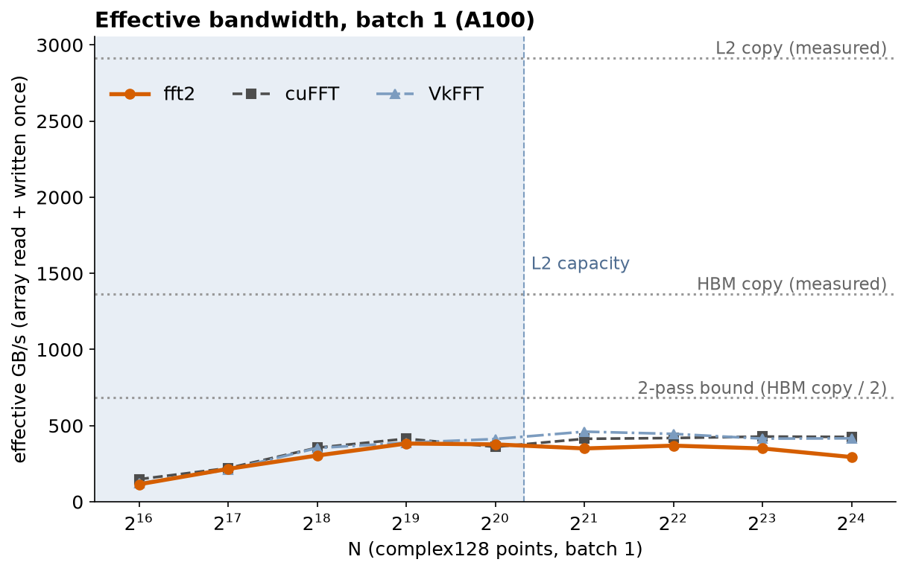
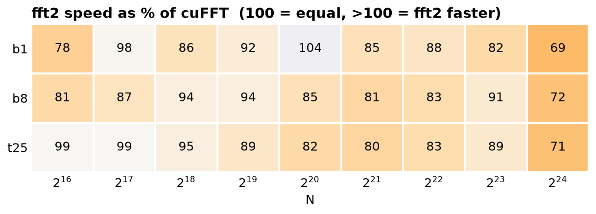
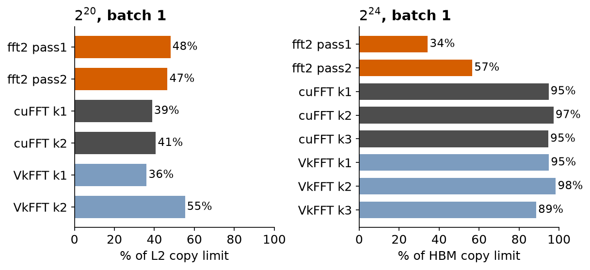

# Two-pass FP64 FFT on A100: how close to cuFFT, and why

A double-precision complex-to-complex forward FFT in CUDA (`fft2/`), for
N = 2^16 – 2^24, batched or not, benchmarked against **cuFFT**, **VkFFT** and
**measured hardware limits** on an A100-SXM4-40GB. Every number below comes
from one GPU allocation, and kernels at representative sizes are profiled
with Nsight Compute.

**Results (27 size × batch configurations, A100, hot median of 15 trials):**

- fft2 runs at **69–104 % of cuFFT's speed (median 86 %)** and **71–104 % of
  VkFFT's (median 91 %)**. It beats cuFFT at 2^20 batch 1 (89.0 vs 93.0 µs).
- At or below 2^23, fft2 is never slower than 78 % of cuFFT.
- Accuracy: relative L2 error vs cuFFT ≤ 6.0e-16 for every configuration.
- The remaining gap is explained per kernel. At 2^24 both passes already move
  exactly the ideal bytes, but pass 1 sustains only 34 % of measured HBM
  bandwidth (see [Where the time goes](#where-the-time-goes)).





## Design

`N = N1 × N2` (N1 = 2^⌊log2 N / 2⌋). The input is viewed as an `N1 × N2` matrix:

1. **Pass 1** does length-N1 FFTs down the columns and applies the cross
   twiddles `W_N^(n2·k1)`.
2. **Pass 2** does length-N2 FFTs along the rows and writes the result
   transposed into natural order.

Each pass reads and writes the array once. That is 2 round trips through
memory. For large N, cuFFT and VkFFT use 3.

Inside a pass, a 256-thread block transforms a tile of adjacent FFTs:

- **Tile sizing for occupancy.** Tiles target 32 KiB of shared memory, with at
  least 2 FFTs per block, so several blocks stay resident per SM.
- **Register-resident first and last stages.** Data goes from global memory
  straight into registers and the first radix stage runs there. The last
  stage also runs in registers, right before the global store. Only the
  middle stages go through shared memory, one barrier each. The structure
  follows VkFFT's generated kernels.
- **Radix chosen per pass.** Radix-16 is used when every thread gets a
  butterfly, otherwise radix-8.
- **Twiddles precomputed in long double.** The length-N cross twiddle is
  factored into two √N-sized tables that stay cache-resident.

Details: [`fft2/README.md`](fft2/README.md). A NumPy model of the kernels'
exact index maps (`fft2/reference/model.py`) is tested on CPU in CI against
`numpy.fft`. It checks that every shared-memory slot is written once per stage
and that the coalescing assumptions hold.

## Where the time goes

Per-kernel Nsight Compute data, batch 1. All limits are **measured** on the
same GPU with a copy kernel: HBM copy 1365 GB/s (88 % of the 1555 GB/s spec)
and L2 copy 2914 GB/s.



**2^24 (512 MiB working set, far beyond the 40 MiB L2)** is judged against HBM:

| kernel | time (µs) | DRAM read / write (MB) | % of HBM copy limit | top stall |
|---|---|---|---|---|
| fft2 pass 1 | 1124 | 270 / 256 | 34 % | long scoreboard 45 % |
| fft2 pass 2 | 677 | 269 / 254 | 57 % | long scoreboard 34 % |
| cuFFT, each of 3 | 392–405 | 269 / 251–254 | 95–97 % | – |
| VkFFT, each of 3 | 387–431 | 269 / 251–253 | 89–98 % | – |

- fft2 moves **less** data than either library: 2 passes instead of 3, and each
  pass is within 1 % of the ideal 268 MB. It still loses on time, because its
  passes run far below the bandwidth limit while every library kernel runs
  near it.
- **Pass 1 is the bottleneck.** A length-4096 column FFT needs 64 KiB of shared
  memory, so a block holds only 2 columns. Each row therefore contributes a
  32-byte segment, and one warp-wide load touches 16 different rows. With a
  single 128 KiB block per SM (12.5 % theoretical occupancy), there are too few
  bytes in flight to cover DRAM latency. The profile shows this: long-scoreboard
  stalls, waiting on global loads, dominate.
- cuFFT and VkFFT avoid this by splitting 2^24 into 3 passes with shorter
  sub-FFTs, so every pass can read wide contiguous segments. That costs 50 %
  more traffic, but each pass runs at roughly 95 % of the limit. The fix for
  fft2 would be the same move: a 3-pass plan above 2^22, or a pass 1 that reads
  more columns per block. This is where the project stopped.

**2^20 (32 MiB working set: data and workspace fit in the 40 MiB L2)** is judged
against L2. DRAM counters undercount here because writes stay in L2. fft2's
passes reach 48 % and 47 % of the L2 copy limit; cuFFT's reach 39 % and 41 %.
This is the size where fft2 is fastest overall: 104 % of cuFFT, 91 % of VkFFT.

## What was tried

The development experiments are preserved at tag
[`experiments-20261113`](../../tree/experiments-20261113), where every variant
can still be selected and rebuilt. Measured on A100 during development:

| change | effect |
|---|---|
| 2-pass structure (first version, radix-4 in shared memory) | correct, ideal DRAM traffic, but only 19–31 % of the bandwidth limit; 1.2–2.9× slower than cuFFT |
| tile sizing for occupancy (32 KiB tiles, ≥ 2 FFTs per block) | 2^20 batch 32: 1.87× faster; 2^22 batch 8: 1.41× faster |
| register radix-8/16 instead of shared-memory radix-4 | 2^24: 1.25× faster; radix-16 only pays off when all threads have work, hence per-pass selection |
| register-resident first/last stages | 2^24: 1.39× faster; 2^22: 1.22×; 2^20: 1.15× (reached cuFFT parity) |
| shared-memory padding against bank conflicts | no reduction in conflicts; forced smaller tiles, slower → dropped |
| twiddles staged in shared memory | 2^24 pass 2: 645 → 1258 µs from new bank conflicts → dropped |
| single length-N cross-twiddle table | 256 MiB table at 2^24 thrashes L2 (4.5× the ideal DRAM reads) → dropped |
| smaller tiles at 2^24 (higher occupancy) | occupancy 12.5 % → 25 %, time unchanged → the limit is per-access efficiency, not occupancy |

## Methodology

- **Timing.** `bench/fft_bench` uses CUDA events. "Hot" is the median of 15
  trials, each timing 20 back-to-back executions. Each configuration runs in a
  fresh process. All implementations run in place on the same seeded input.
- **Correctness.** In the same process, every result is compared with cuFFT
  (relative L2 threshold 1e-12). Separately, `fft2/fft2_test` covers
  2^16–2^24 × batch {1, 3, 8}, both in place and out of place.
- **Limits.** `tools/bwtest` measures HBM read, write and copy over a launch
  sweep, and the L2 plateau over a working-set sweep. Per-kernel percentages
  divide achieved bytes per second by these measured limits, not by spec
  sheets.
- **Profiling.** Nsight Compute 2025.3.1 with `--cache-control all` and
  `--clock-control none`, filtered by NVTX to the transform's own kernels.
  Sizes 2^16, 2^20, 2^22 and 2^24 are profiled at batch 1 and at the large-batch
  setting.
- **Batch modes.** `b1` = batch 1; `b8` = batch 8; `t25` = N × batch = 2^25
  elements (512 MiB).
- **Repeatability.** A second full sweep in the same allocation reproduced the
  first: median difference 0.06 %, worst case 1.8 % (cuFFT, 2^16 batch 1).
- **Environment.** A100-SXM4-40GB (Google Colab), CUDA 13.0, driver 580.82,
  `sm_80`. VkFFT v1.3.4 (git submodule), CUDA backend.

Raw data: [`results/final_a100_20261113/`](results/final_a100_20261113/)
(sweep CSVs, bandwidth limits, ncu summaries, VkFFT's generated kernels).
[`docs/img/tables.md`](docs/img/tables.md) has every timing in table form.

## Reproduce

```bash
git clone --recursive https://github.com/justin3728/cuda-fft-optimization.git
cd cuda-fft-optimization

make CUDA_ARCH=sm_80 && fft2/fft2_test          # correctness vs cuFFT
make -C fft2 test-cpu                           # CPU: NumPy model + tile policy

# Full measurement: limits, 3-way sweep, Nsight Compute, summary (~10 min on A100)
CUDA_ARCH=sm_80 scripts/run_t1_all.sh --tag myrun
python3 scripts/analysis/plot_final.py results/myrun --out docs/img
```

Requires the CUDA Toolkit (with cuFFT and Nsight Compute), and Python 3 with
NumPy, matplotlib and pytest.

## Layout

```text
fft2/                 the FFT library (fft2.h, fft2.cu), GPU test, NumPy reference model
bench/                benchmark driver with cuFFT, VkFFT and fft2 backends
tools/bwtest.cu       HBM / L2 bandwidth limit measurement
scripts/              sweep, profiling and analysis pipeline (run_t1_all.sh)
tests/                tests for the analysis pipeline (CPU, run in CI)
results/              final A100 data
docs/img/             figures and tables in this README
third_party/VkFFT     VkFFT v1.3.4 (submodule)
```
