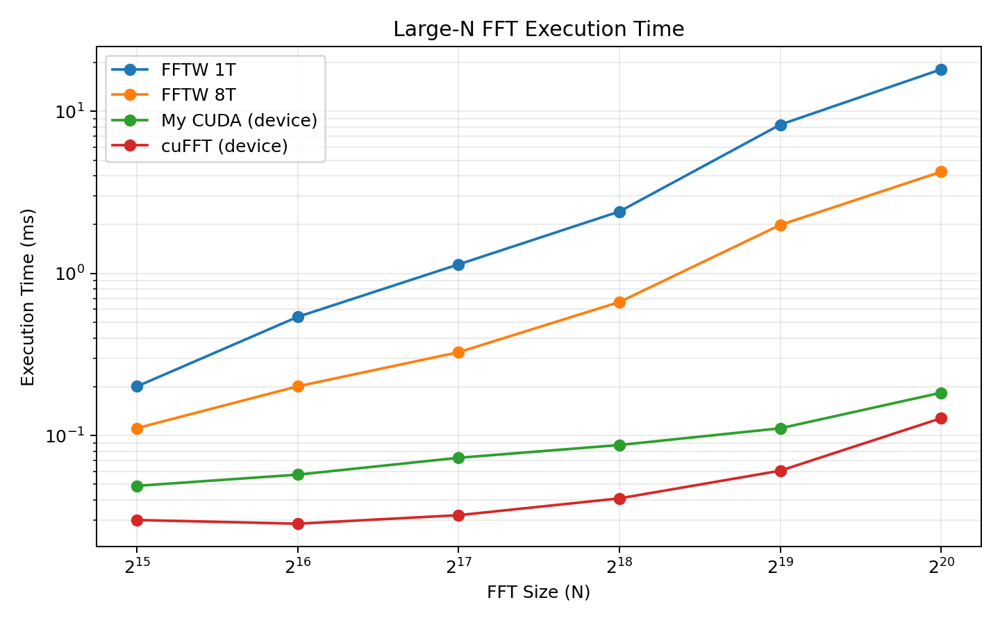
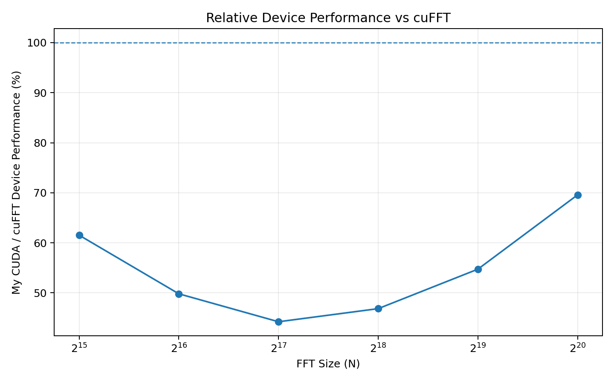
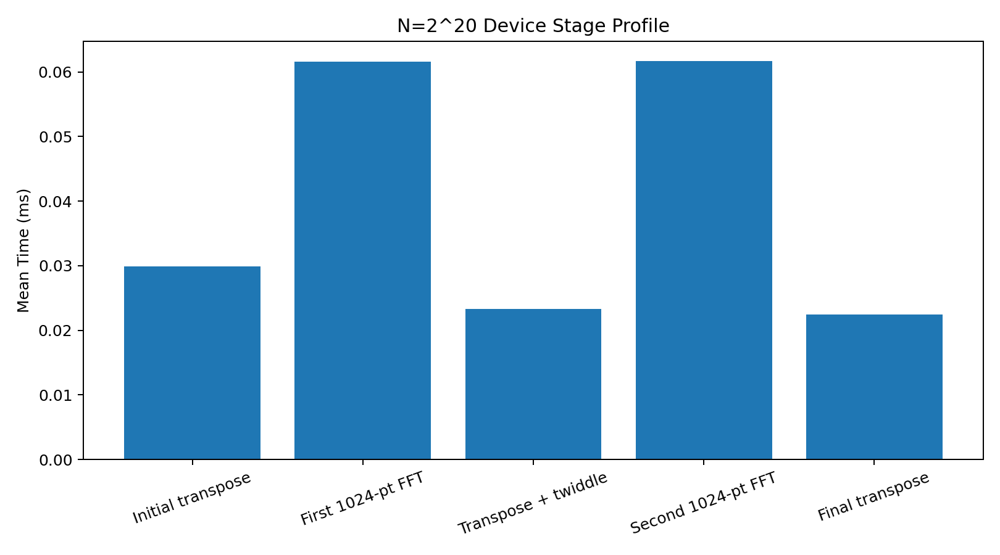

# CUDA FFT Optimization

A double-precision CUDA FFT implementation for power-of-two inputs up to `N = 2^20`, using mixed-radix and Four-Step FFT decomposition.

The project focuses on reducing GPU memory traffic and optimizing the hot 1024-point FFT path while preserving a generic fallback for other supported sizes.

## Highlights

- Tiled shared-memory transposes for efficient global-memory access.
- Fused transpose-and-twiddle computation to reduce memory traffic.
- In-place final transpose for the square large-N path, eliminating an extra device-to-device copy.
- Specialized 1024-point FFT path using compile-time radix-4 stages and register blocking.
- At `N = 2^20`, reached **69.6% of NVIDIA cuFFT device performance** with a maximum absolute error of **3.08e-12**.
- At the same size, device execution was **98.9x faster than single-threaded FFTW** and **23.1x faster than 8-thread FFTW**.

For large transforms, the execution pipeline is:

```text
transpose -> row FFT -> transpose + twiddle -> row FFT -> final transpose
```

The stages execute in order because of data dependencies; each CUDA kernel internally runs in parallel across GPU threads.

## Performance

Benchmark environment:

| Setting | Value |
|---|---|
| GPU | NVIDIA A100-SXM4-40GB |
| CPU | Intel Xeon @ 2.20 GHz |
| Precision | Double-precision complex (FP64) |
| Direction | Forward FFT |
| Batch size | 1 |
| Warmup / repetitions | 20 / 100 |
| FFTW planner | `FFTW_MEASURE` |
| FFTW multi-thread setting | 8 threads |

### N = 2^20

| Implementation / Metric | Result |
|---|---:|
| FFTW 1 thread | 18.1515 ms |
| FFTW 8 threads | 4.2354 ms |
| My CUDA device | 0.1835 ms |
| NVIDIA cuFFT device | 0.1277 ms |
| My CUDA end-to-end | 2.9380 ms |
| NVIDIA cuFFT end-to-end | 2.7473 ms |
| My CUDA / cuFFT device performance | 69.6% |
| Maximum absolute error vs cuFFT | 3.08e-12 |

### Large-N execution time



The full benchmark sweep is available in [`results/benchmark_results.csv`](results/benchmark_results.csv), with an additional full-range plot in [`results/execution_time_full.png`](results/execution_time_full.png).

### Relative device performance



### N = 2^20 stage profile



The two specialized 1024-point row-FFT stages account for approximately **62%** of the profiled device time at `N = 2^20`.

## Benchmark Methodology

- FFTW, My CUDA, and cuFFT use double-precision complex forward FFTs.
- FFTW planning and thread setup are outside the timed region; FFTW timing measures execution only.
- CUDA device time is measured with CUDA events and excludes H2D/D2H transfers.
- End-to-end CUDA latency includes H2D, FFT execution, D2H, and stream synchronization.
- Planning, allocation, and input initialization are excluded from execution timing.
- Accuracy is checked against NVIDIA cuFFT.

Raw benchmark output and environment metadata are included under [`results/`](results/).

## Build and Run

Requirements:

- Linux
- CUDA Toolkit
- NVIDIA cuFFT
- FFTW3 with thread support
- C++ compiler with OpenMP support

Build for NVIDIA A100:

```bash
make -B CUDA_ARCH=sm_80
```

Run the benchmark:

```bash
./benchmark --fftw-threads 8
```

Optional stage profiling:

```bash
make -B profile_stages CUDA_ARCH=sm_80
./profile_stages
```

## Repository Structure

```text
.
├── README.md
├── Makefile
├── fft_cuda.cu
├── fft_cuda.h
├── benchmark.cpp
├── profile_stages.cu
└── results/
    ├── benchmark_results.csv
    ├── benchmark_metadata.txt
    ├── execution_time_large_n.png
    ├── execution_time_full.png
    ├── relative_performance.png
    ├── stage_profile.png
    └── stage_profile.txt
```
